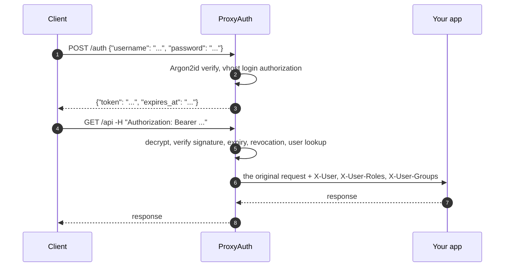

<div align="center">
<h1>ProxyAuth (Community Edition)</h1>
<br>

</div>
<br>


[](https://github.com/vBlackOut/ProxyAuth/actions/workflows/proxyauth.yml)


[](https://crates.io/crates/proxyauth)

[](https://discord.gg/sKPRWzYdCy)

**Put a login in front of anything, without touching its code.**

ProxyAuth is a reverse proxy that authenticates and authorizes every request *before* it reaches your application. The app behind it needs no login page, no session store, no auth library, no framework plugin — it receives an already-verified identity in a header and gets on with its job.

That holds whether it is written in Rust, Go, PHP, Python, or is a vendor binary you cannot modify at all. Securing an application stops being a project with dependencies to integrate and becomes a few lines in a configuration file — or, now, three CLI commands.

---

## Start here

```bash
proxyauth quickstart vhost          # a domain, TLS, and the app behind it
proxyauth quickstart users          # an account
proxyauth quickstart vhost-access   # who is allowed to sign in
```

Each one asks a handful of questions, every question has a default, **shows you the exact configuration block before writing anything**, and prints it again afterwards with its file path — so the next one you can write by hand. Nothing is touched until you say yes, and every write keeps a timestamped backup.

That is the whole onboarding. The rest of this file explains what you just configured, and what else is available once you need it.

---

## Table of contents

- [What ProxyAuth actually does](#what-proxyauth-actually-does)
- [Install](#install)
- [The three quickstarts, in detail](#the-three-quickstarts-in-detail)
- [What it can secure](#what-it-can-secure)
- [Two files, two scopes](#two-files-two-scopes)
- [Identity and accounts](#identity-and-accounts)
- [TLS and certificates](#tls-and-certificates)
- [Operating it](#operating-it)
- [Auditing what you configured](#auditing-what-you-configured)
- [Performance and security model](#performance-and-security-model)
- [Docker](#docker)
- [Documentation and contributing](#documentation-and-contributing)

---

## What ProxyAuth actually does

A request arrives. Before your application ever sees it

Your application receives an **identity**, never a credential. The token stays between the client and ProxyAuth. A backend sitting behind a `required_login` route can trust `X-User` without implementing a single line of authentication — and a client-supplied copy of that header is always stripped before forwarding, so it cannot be used to impersonate anyone.

The order is part of the contract, not an implementation detail. IP blocklists run before everything, so nothing downstream can be used to get around them. ACME challenge handling runs before the maintenance gate, so putting a site into maintenance can never lock you out of renewing its certificate.

---

## Install

```bash
curl -fsSLO https://proxyauth.app/install.sh
less install.sh        # read it first
sudo sh install.sh
```

Twelve steps on Debian, Ubuntu, Alpine, Arch or Fedora: detects the distribution, installs build dependencies through *your* package manager, downloads the source crate over HTTPS, verifies it against its published SHA-256, compiles it locally with the versions pinned in `Cargo.lock`, creates an unprivileged `proxyauth` system account, and installs a systemd or OpenRC unit. A full transcript lands in `/tmp/proxyauth-install.log`.

Re-running it is safe — an existing account, certificate or Rust toolchain is reused rather than replaced.

The service runs as `proxyauth`, with `CAP_NET_BIND_SERVICE` as its only capability and `NoNewPrivileges` set. It is never root once its listeners are bound.

---

## The three quickstarts, in detail

### `quickstart vhost` — a domain and the app behind it

Six questions: the hostnames, how TLS is handled, whether browsers or scripts talk to it, who may sign in, where the backend is, and whether to serve a login page from disk.

The browser-or-scripts answer is the one people most often get wrong on their own, so it is asked directly rather than left to be inferred: browsers get `session_cookie` and CSRF, scripts get bearer tokens and no CSRF. Everything else follows from it.

<details>
<summary>What it writes</summary>

```yaml
vhosts:
  - vhost: ["tool.example.com"]
    vhost_cert:
      cert: "/etc/proxyauth/cert/tool.example.com/fullchain.pem"
      key: "/etc/proxyauth/cert/tool.example.com/privkey.pem"
    certbot_renew: true
    allow_groups: ["staff"]
    session_cookie: true
    tag_csrf_token: true
    login_redirect_url: "/app"
    logout_redirect_url: "/"

    routes:
      # The login page is public by definition — nobody can sign in
      # through a page that already requires being signed in.
      - prefix: "/"
        static: "/var/www/login/"
        static_index: "login.html"
        tag_proxyauth: true
        cache: false

      - prefix: "/app"
        target: "http://127.0.0.1:8000"
        required_login: true
        forward_proxy_headers: true
```

`routes.yml` is edited as text and re-parsed with the real deserializer before the write is committed: your comments survive, and a block that would stop the server from starting is rolled back instead of left on disk.

</details>

### `quickstart users` — an account

Detects whether a `databases` block is configured and offers both destinations. The password is read twice with hidden input and stored as an Argon2id hash — it is never written in clear, anywhere.

A database account is live on every instance within seconds, through the incremental scan. A `config.json` account needs one restart, and the command says so rather than leaving you to wonder why the login fails.

It finishes by printing the equivalent `db-add-user` invocation, so the second account can skip the wizard entirely.

### `quickstart vhost-access` — who may sign in

Lists the vhosts you have, **shows what is in force right now** — resolved through the same code path the running server uses, not a re-reading of the file — and then sets `allow_users`, `allow_groups`, `allow_roles` and `exclude_users`.

This is the gate at login, and it is deliberately separate from what a route lets an already-signed-in visitor reach. A vhost that names nobody accepts no login at all: adding a domain to a live instance does not silently hand it every account that exists elsewhere in the system.

`exclude_users` beats every allow rule, including a direct username match — for carving out one exception without restructuring the lists.

---

## What it can secure

Seven shapes covering most of what people actually deploy. All of them are configuration only; none of them require the application to change.

| You have | ProxyAuth gives you |
|---|---|
| **An internal tool with no login of its own** | A login page in front of it, sessions, optional TOTP, and `X-User` handed to the app |
| **An HTTP API** | Bearer tokens from `/auth`, per-route method and IP restrictions, separate rate limits for auth and traffic |
| **A public site with an admin area** | One backend, two policies — `/` open and cached, `/admin` gated on a group |
| **Several apps on several domains** | One process, one certificate per vhost via SNI, independent session policy, SMTP and login rules per domain |
| **An app that already speaks OIDC** | ProxyAuth becomes its identity provider — real, verifiable `id_token`, PKCE mandatory, six standard endpoints |
| **Several instances of one app** | Weighted round-robin, a cold-standby weight of `-1`, and a cooldown on anything that times out |
| **A deployment window** | One block, reloaded live: everyone but your IP range gets a maintenance page, with certificate renewal still working |

Beyond those, the middleware layer covers things that usually mean patching the app: stripping one HTML element from a response based on a live session check (`hidden_blocks`), substituting `{{ username }}` and `{{ csrf_token }}` into static files, response headers and CSP, brotli/gzip compression, streamed responses for git and package traffic, request filters on method, path, header, query or JSON body, and mTLS to a backend that demands a client certificate.

---

## Two files, two scopes

| File | Scope | Reload | Holds |
|---|---|---|---|
| `config.json` | the whole instance | restart | listeners, secret, rate limits, database, logging, blocklists |
| `routes.yml` | vhost and route | **live** | routing, TLS, sessions, CSRF, OIDC, middleware, backends |

Nine settings that live globally in `config.json` can be overridden per vhost in `routes.yml` — session cookies, CSRF, redirects, TOTP, the password-reset page, cookie lifetime, CORS and SMTP. That is what makes one process able to host domains with genuinely different policies.

<details>
<summary><code>config.json</code> — a minimal working file</summary>

```json
{
  "secret": "a-random-value-of-at-least-64-characters-generated-not-typed",
  "token_expiry_seconds": 3600,
  "host": ["0.0.0.0", "::"],
  "port": 443,
  "tls": true,
  "session_cookie": true,
  "csrf_token": true,
  "log": { "type": "local" },
  "letsencrypt": { "contact_email": "ops@example.com" },
  "ratelimit_auth":  { "requests_per_second": 5,   "burst": 10,  "block_delay": 1000 },
  "ratelimit_proxy": { "requests_per_second": 200, "burst": 400, "block_delay": 200 },
  "users": [
    { "username": "alice", "password": "changeme", "groups": ["staff"] }
  ]
}
```

A plaintext `password` is hashed with Argon2id in place on first startup — you never hash one by hand, and it never stays readable in the file.

Treat this file as a credential: it holds `secret`, `token_admin`, `databases.password` and each user's `otpkey`. `proxyauth prepare` sets its permissions for you.

</details>

<details>
<summary><code>databases</code> — shared accounts across instances</summary>

```json
"databases": {
  "type": "postgres",
  "host": "127.0.0.1",
  "port": 5432,
  "db_name": "proxyauth",
  "user": "proxyauth",
  "password": "changeme",
  "connect_timeout_secs": 5,
  "refresh_interval_secs": 30,
  "full_refresh_interval_secs": 300
}
```

`"type"` is `"postgres"` or `"mysql"`. Seven tables, one trigger and two indexes are created automatically at startup — the account needs DDL rights on the first run, or you can create the schema by hand and keep the runtime account narrow.

Two scans keep instances in step. An **incremental** scan reads only rows changed inside a lookback window, which is what makes a new account usable within seconds. A **full** scan is the backstop for a row hard-deleted straight from SQL — and a trigger writes those into `deleted_users_log` so even that is noticed quickly rather than at the next full pass.

A local LMDB cache mirrors the last successful full read and is consulted **only** when the database cannot be reached at all. Writes never go there: `db-add-user` refuses rather than writing somewhere that would silently vanish on the next sync.

**Build requirements** — the client libraries for whichever backend you use:

| Distro | PostgreSQL | MySQL/MariaDB |
|---|---|---|
| Debian/Ubuntu | `libpq-dev` | `default-libmysqlclient-dev` |
| Arch/Manjaro | `postgresql-libs` | `mariadb-libs` |

Plus `pkg-config` (`pkgconf` on Arch).

</details>

---

## Identity and accounts

Accounts live in `config.json`, in a shared database, or both — a login is checked against both, and the two behave identically from the application's point of view because the database schema mirrors the file format exactly.

**Groups gate routes. Roles do that too, and are also forwarded** to the backend as `X-User-Roles` for its own authorization logic. Use groups when the grouping means nothing to the app, roles when it does.

**TOTP** works the same for both storage backends, and enrollment or reset takes effect immediately without a restart — a file-based account goes through an in-memory overlay, a database account through the mirror that is refreshed for that one user right after the write.

**Password reset** generates a single-use, hour-long token stored in its own LMDB environment, validated and consumed in one atomic transaction. The email itself is a plain-text template on disk at `/etc/proxyauth/mail/templates/reset_password.txt` — yours to rewrite, never overwritten by an upgrade.

**Revocation** is immediate on the node that performs it and reaches the rest of a fleet within one 15-second sync tick when `redis` is configured. Redis is the transport; each node keeps its own LMDB copy, so losing Redis never stops a node from enforcing what it already knows. Logging out revokes server-side rather than only clearing the cookie — a token copied beforehand stops working too.

---

## TLS and certificates

ProxyAuth issues and renews its own Let's Encrypt certificates natively. There is no certbot daemon to install and no renewal cron to write.

```bash
proxyauth certbot new app.example.com     # first issuance
proxyauth certbot check app.example.com   # status, days left, SANs
```

An hourly scan renews anything with 30 days or fewer left, and the new file is picked up **without a restart** — the watcher follows the containing directory rather than the file, so it survives the inode swap that every atomic renewal performs.

When `tls` is on and any route sets `certbot_renew`, a plain-HTTP listener is bound on port 80 automatically, answering ACME challenges and redirecting everything else to HTTPS. If that port is already taken, the address is logged and skipped — startup continues normally.

Wildcard certificates need DNS-01, which is manual and excluded from automatic renewal. That is a Let's Encrypt constraint, not a ProxyAuth one, and `certbot check` reports the days remaining so you can set a reminder.

---

## Operating it

**Logging** is two independent settings. `log` chooses the transport — local files, Grafana Loki over HTTP with no agent to install, a generic HTTP sink, or nothing. `logging` shapes the per-request access line: a format string of placeholders, with on/off switches per vhost and per route. Turning off access lines for a health endpoint leaves warnings and errors intact.

**Live statistics** over a local Unix socket, with filesystem permissions as the authentication:

```bash
proxyauth stats
```

The same figures are available at `GET /adm/stats` for a monitoring system that is not on the host.

**IP abuse blocklists** — Spamhaus DROP, FireHOL, an AbuseIPDB export, your own file — fetched on a timer, merged, cached locally, and checked before routing. A third-party outage falls back to the last good copy rather than blanking the list. Note that behind a load balancer this only works once that balancer is listed in `trust_proxy_forward_for`; without it, ProxyAuth checks your own balancer's address and the blocklist silently protects nothing.

**Across instances**, tokens depend on per-build constants as well as `secret`, so two independently built instances reject each other's tokens by default. `proxyauth sync export` / `proxyauth sync` is how a fleet is made to agree.

---

## Auditing what you configured

Four read-only commands, all using the **exact same decision function the proxy enforces** — they cannot silently drift from real behaviour.

```bash
proxyauth routes-audit                      # what secures each route
proxyauth check-access --username alice     # one account, every route, and why
proxyauth check-routes                      # every route resolved to real accounts
proxyauth users --list                      # accounts, file and database alike
```

`check-routes` flags a route secured by a group or role that no current account matches — almost always a typo, and something an audit of the rules alone cannot surface.

---

## Performance and security model

Around **180,000 requests/second** under load on a single instance.

Tokens are sealed with ChaCha20-Poly1305 and signed with HMAC-BLAKE3. The key is derived once at startup, through HKDF, from your `secret` **plus** a 32-byte per-build salt drawn from the OS CSPRNG at compile time — so `secret` alone is not enough to forge a token without the matching binary. The binding is applied in key derivation, not recomputed per signature, so verification costs the cryptography and nothing more.

A bounded cache holds up to 50,000 successful verifications. The bound is deliberate: the cache key is an attacker-supplied string, and an unbounded map keyed on one is a memory-exhaustion primitive. Revocation, user lookup and the expiry policy are re-checked after **every** vault call, cached or not — which is why revoking a token or lowering `token_expiry_seconds` takes effect immediately rather than when an entry ages out.

Rate limiting is **per user, not per token**. Someone who mints 150 tokens and uses them at once is still one user against the limit. `/auth` has its own separate limiter, so a burst of bad credentials cannot starve real traffic, and the reverse.

Ten connection-specific headers are stripped in both directions and regenerated, which removes the proxy/backend disagreement that request smuggling depends on rather than trying to detect it.

<details>
<summary>The token flow, drawn out</summary>



With `session_cookie: true` the same flow serves a browser instead: `/auth` answers `303` and attaches a `Secure; HttpOnly; SameSite=Strict` cookie, and CSRF applies.

</details>

---

## Docker

```bash
git clone https://git.proxyauth.app/ProxyAuth/Docker ProxyAuth && cd ProxyAuth/latest
docker compose build
docker compose up -d
```

Mount your own files over the defaults:

```yaml
volumes:
  - ./config/config.json:/app/config/config.json
  - ./config/routes.yml:/app/config/routes.yml
```

Inside a container the installer skips the service step and installs only the binary.

---

## Documentation and contributing

Full reference, every field of both files, at **[proxyauth.app](https://proxyauth.app)**.

Want to improve the docs? [ProxyAuth-Docs](https://github.com/vBlackOut/ProxyAuth-Docs) :heart:
Questions, or want to show what you built with it? [Discord](https://discord.gg/sKPRWzYdCy).

### A note on the trade-off

The security of every token ultimately rests on `secret`. Use 64 characters or more, generated rather than typed. This is the same dependency Django places on `SECRET_KEY`, and it deserves the same treatment: back it up the way you back up private keys, and never commit it.

---

<sub>Apache-2.0 · Community Edition</sub>
